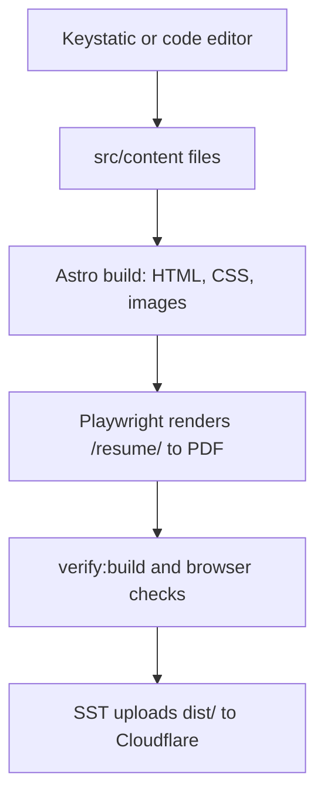

# Architecture

## Decisions

- **Static output.** Pages are rendered at build time; visitors never hit a server or API.
- **One package.** Site, editor config, scripts, and infrastructure share one `package.json`.
- **Content in Git.** Schemas in `src/lib/content/schemas.ts` are the source of truth for Astro;
  `keystatic.config.ts` mirrors them and `tests/keystatic-schema.test.ts` keeps field names aligned.
- **Résumé from the same model.** `src/lib/resume/model.ts` composes the résumé; `scripts/build-resume.ts`
  renders the PDF from the built HTML and generates the Word file from the same model.
- **Editor exclusion.** `astro.config.ts` adds Keystatic only for `astro dev`; `pnpm verify:build`
  and `pnpm test:e2e` confirm the built artifact contains no editor routes.
- **Drafts.** Unpublished posts, projects, and roles never produce routes, navigation, or sitemap
  entries. The Writing index exists only once an article is published.
- **Contact email.** Read from `CONTACT_EMAIL` at build time, stored obfuscated, and decoded in the
  browser; it is never committed or written to HTML as plain text.
- **TypeScript.** `pnpm typecheck` runs the native TypeScript 7 compiler plus `astro check`. The
  TypeScript 6 API package remains only because ESLint and Astro tooling require it
  (see [development.md](development.md)).

## Layout

- `src/pages`, `src/layouts`, `src/components`, `src/styles` — public site
- `src/lib` — content queries, validation, résumé composition
- `scripts` — build orchestration (résumé generation, content and artifact checks)
- `tests` — unit tests and `tests/e2e` production-browser checks
- `sst.config.ts` — Cloudflare static hosting
