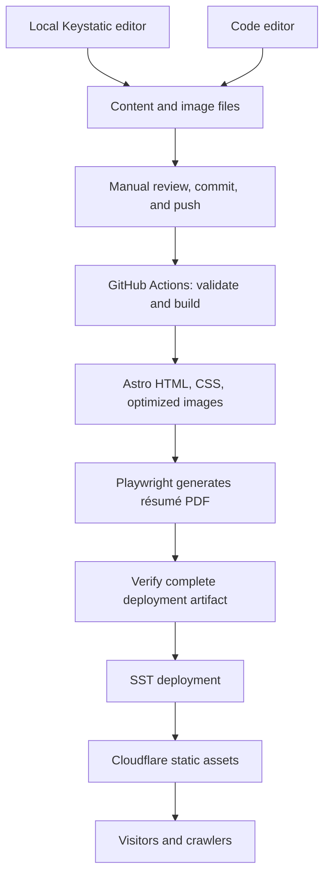

# erid.dev — project plan

Status: **Implemented; retained as the historical design plan.**

Prepared: October 27, 2026. Target: `/Users/erid/Development/erid.dev`.
Repository: `git@github.com:Erid/erid.dev.git`.

This document records the original planning decisions. The site is implemented and published. Current behavior and operating instructions live in README.md, development.md, architecture.md, and deployment.md. Historical proposals below are not a current task list or publication authorization.

## 1. Product goal and agreed decisions

Build a professional website that helps recruiters quickly identify Erid's role, core technologies, work history, and evidence of shipped software, with immediate access to his résumé. The visual direction is **Approachable Professionalism: Clean UI with depth**. Personality comes through concise conversational writing, an intentional headshot, and optional deeper stories. The source code should itself be a useful portfolio piece: approachable, reproducible, and easy to maintain.

| Area | Decision |
| --- | --- |
| Audience | Recruiters, interviewers, collaborators, and people interested in Erid's work |
| Design | Approachable Professionalism: Clean UI with depth; recruiter-focused summaries and optional deeper stories |
| Language | English only; no localization infrastructure |
| Website | Astro, TypeScript, static production output |
| Content | Repository files; no external content database |
| Editor | Keystatic in local mode, available during local development only |
| Publishing | Erid edits locally, reviews changes, and manually commits/pushes |
| Infrastructure | SST managing Cloudflare static hosting and relevant domain configuration |
| Package manager | pnpm exclusively, with a committed lockfile |
| Type checking | Stable TypeScript 7 compiler, with the approved TypeScript 6 API compatibility package where tooling requires it |
| Code quality | ESLint, Prettier, IDE fixes on save, command-based autofixing for agents |
| Repository structure | One package; no multi-package workspace or task orchestrator |
| Licensing | MIT for code; personal content, résumé, writing, and original images separately reserved |
| Primary domain | Proposed: `erid.dev`; `erid.cr` can later redirect, preserving paths |

The initial version has no visitor accounts, production editor, database, contact-form backend, comments, subscriptions, or application features. Future substantial applications belong in separate projects. A blog and deeper project/experience pages remain within this site's content scope.

## 2. Architecture



The website reads content at build time. Visitors receive HTML and static files without GitHub API calls, database access, or a server-rendered page request. Keystatic's editor and file-writing endpoints are excluded from every production build, including previews of production output.

The build produces the website and PDF from the same content revision and deploys them together. Infrastructure changes remain in TypeScript alongside the site. The static output can be hosted elsewhere later, although provider-specific SST configuration would need changing.

## 3. Tooling and compatibility gate

Before building the visual site, create a small vertical slice that proves the chosen versions work together. This is the first implementation milestone after approval.

### TypeScript 7

Microsoft's current release documentation confirms that TypeScript 7 is stable and describes a side-by-side arrangement for tools that require the TypeScript 6 API. The current typescript-eslint support range is `>=4.8.4 <6.1.0`. We will use the approved compatibility approach, not a preview compiler or suppressed compatibility warnings. [1][2]

- Pin a stable TypeScript 7 release for the compiler. Use Microsoft's documented package alias arrangement if the integration still requires it at implementation time.
- Supply the supported TypeScript 6 compatibility API to ESLint and any Astro tooling that needs it. Document why both appear in the dependency tree.
- `pnpm typecheck` must run the TypeScript 7 compiler for ordinary TypeScript/TSX and the appropriate Astro checker for `.astro` files. Plain `tsc` does not check `.astro` templates. [3]
- Include content utilities, scripts, Keystatic configuration, and infrastructure configuration in checking. Account explicitly for any SST-generated type declarations so a fresh checkout can reproduce the check without deploying resources.
- Verify editor diagnostics for both TypeScript and Astro. The native TypeScript language service and Astro's language tooling may use different backends; document this accurately.
- Do not claim all tools run on TypeScript 7 when a compatibility checker remains involved.
- Remove compatibility dependencies only after the relevant tools support the selected TypeScript 7 API and the complete checks pass.

The smoke test must prove: local editing writes a real file; a TS7-detectable error fails the command; an Astro prop/type error fails the Astro checker; ESLint autofixes work; Prettier formats an Astro component; and a production build excludes Keystatic while rendering that content correctly. Temporary deliberately invalid examples are removed after verification.

### pnpm and the workspace decision

Use one `package.json`, one lockfile, and root-level scripts. The site, local editor, scripts, and infrastructure do not have independent release cycles or consumers, so separate packages would add coordination without a clear benefit.

A `pnpm-workspace.yaml` may still be appropriate for pnpm's project settings, dependency build-script approvals, or version-specific configuration. Its presence does not mean we need an `apps/*` / `packages/*` monorepo. Current pnpm documentation uses this file for project settings as well as workspace membership. Include only settings actually required by the pinned pnpm version. [4]

- Pin pnpm in `packageManager` and choose a supported Node LTS release compatible with all selected tools.
- Commit `pnpm-lock.yaml`; CI uses `pnpm install --frozen-lockfile`.
- Use the normal shared pnpm store. Do not create a repository-local store, duplicate dependency trees, or enable broad hoisting to conceal dependency errors.
- Review required install scripts for dependencies such as native image/build tools; allow the specific packages needed.
- Revisit multi-package workspaces only when a genuinely independent reusable package emerges. A future separate app is not a reason to prepare one now.

## 4. Pages and visual direction

| Route | Purpose | Initial content |
| --- | --- | --- |
| `/` | Fast professional overview | Clear role, core stack, visible PDF download, concise positioning, selected employers/roles, and proof-of-work links; optional small headshot |
| `/about/` | Background and working style | Longer biography and personal context supplied by Erid |
| `/experience/` | Scannable professional history | Employer, role, dates, technologies, concise contributions, and optional links to deeper stories |
| `/experience/[slug]/` | Optional experience case study | A specific challenge, Erid's contribution, architectural/product decisions, trade-offs, and verified outcomes; generated only when a story is supplied |
| `/projects/` | Selected work | Publish when at least one approved project has sufficient content |
| `/projects/[slug]/` | Project or case study | Context, Erid's contribution, decisions, outcomes, media, relevant links |
| `/writing/` and `/writing/[slug]/` | Optional articles | Publish navigation and index only when real articles exist |
| `/resume/` | Accessible web résumé | Curated résumé view with a prominent PDF download |
| `/resume/erid-baldioceda.pdf` | Finished PDF | Generated from the curated résumé model |
| `/404.html` | Useful error page | Clear message and navigation back into the site |

The structure is expandable without publishing empty sections or placeholder articles. The homepage and résumé are the priority. An about page can initially be concise; deeper biography and case studies depend on Erid's additional background. The professional overview must stand on its own: reading a biography or opening a case study is optional.

### Recruiter-focused information hierarchy

Use a ten-second scan as a design review goal, not as a claim about measured recruiter behavior. The first view should communicate the role and core stack and provide an obvious résumé download. A short scan of the homepage should answer where Erid has worked and show the available evidence of his engineering work.

Recommended homepage order:

1. **Professional identity and primary actions.** Name, precise target role/headline, location, a compact line of core technologies, and one or two sentences of positioning. A clearly labeled **Download résumé (PDF)** links directly to the file, alongside a secondary GitHub or contact link. Use a small professional headshot if provided; it must not dominate the opening view.
2. **Experience at a glance.** Recognizable employer names, roles, and dates with short contribution summaries and relevant technologies. Make the recent/current roles easy to scan, with a clear link to the full history.
3. **Selected work and evidence.** A small number of projects with a concise problem/contribution summary, technologies, and clearly differentiated **Live demo**, **View code**, and **Read case study** links when those destinations actually exist. This site's public repository is itself a legitimate example, with its architecture explained accurately. Approved professional case studies can supply useful evidence when a product's source is private.
4. **Optional personal depth.** A brief human introduction and links to about, detailed experience stories, or writing. This layer enriches the overview for visitors who want more context.
5. **Contact and résumé access.** Repeat the important actions near the end of the page without adding a distracting persistent overlay.

Keep the navigation simple, with résumé access visible in the header. On mobile, expose the PDF action without requiring visitors to open a menu, and retain the role and stack near the start of the document. Do not force every employer or project into the first viewport: use clear hierarchy and compact, readable sections rather than crowding the layout.

### Progressive disclosure

The surface layer carries the facts: role, employer, dates, technologies, concise contribution, and available proof. Detail pages carry the richer story: the challenge, constraints, Erid's responsibilities, alternatives considered, architectural and UX decisions, trade-offs, and verified outcomes or lessons.

Use normal crawlable links to these pages so they work without client JavaScript and can be shared directly. Visitors should not need to open accordions, carousels, hover states, or a modal to find essential qualifications. A case study can be valuable without invented success metrics or access to proprietary code. Do not publish empty detail pages or generic “learn more” links without a real destination.

### Visual treatment

- Clean UI with readable, clearly separated sections; warm neutrals and one restrained accent color provide approachability.
- Strong typographic hierarchy, concise headings, and visible employer/title/date relationships. Technologies are readable text or compact labels, not icon-only information or skill percentages.
- A welcoming professional headshot is optional. Project screenshots illustrate functioning software or a specific technical point; lifestyle photography is not a homepage prerequisite.
- Personality comes through conversational copy and deeper stories. Keep the opening introduction short and keep long narrative passages on detail pages.
- Self-host a small number of licensed font files and weights, or use system fonts if equally effective.
- Prefer clear navigation and meaningful content over animation. Avoid entrance sequences that delay the headline, résumé action, or evidence; respect reduced-motion preferences.
- Start with one carefully designed light theme. A theme switch is outside the first version unless requested during design review.
- Use native CSS with design tokens and Astro-scoped component styles. No component framework is needed. React is available for Keystatic and justified interactive pieces, but public pages should not hydrate React by default.

Review a representative desktop and mobile homepage alongside the résumé before polishing every route. Check whether a visitor can identify the core stack, find recent employers/roles and dates, access available demos/source, and download the PDF directly. Adjust the hierarchy before adding visual decoration. This is an implementation checkpoint, not a requirement to settle every visual detail now.

## 5. Content model and authoring

Keep content files portable and readable. Use YAML for structured entries and Markdown-compatible authoring for longer narratives. Confirm Keystatic's round-trip behavior first; if its rich-text format requires Markdoc, use its documented format deliberately and document the extension instead of pretending arbitrary Markdown is losslessly editable. Avoid embedded application code in ordinary editorial content. [5]

| Model | Core fields |
| --- | --- |
| Profile singleton | Name, headline, introduction, biography, location, approved contact/social links, portrait and alt text |
| Experience collection | Stable ID/slug, employer, title, date range and precision, location/work arrangement, employment type when known, concise contributions, associated technologies, longer description, links, optional case-study body and publication flag |
| Education collection | Institution, qualification, subject, date range and optional details |
| Certifications collection | Name, issuer, dates, optional credential URL; add records only when verified |
| Skills | Stable names/grouping; associations to experience where verified; no invented proficiency levels |
| Projects collection | Title, concise problem/contribution summary, slug, dates if relevant, Erid's role, technologies, verified outcomes when available, optional case-study narrative, separately labeled live/repository links, images with alt text, related experience, featured flag |
| Posts collection | Title, slug, summary, publication/update dates, draft flag, body, optional cover image |
| Résumé singleton | Professional summary, selected experience IDs and order, résumé-specific bullets, selected skills, education, public contact fields |

Content rules:

- Validate required fields, URL formats, unique slugs/IDs, résumé references, date ordering, image existence, and required alt text during the build/check pipeline.
- Use stable IDs so renaming a title does not break résumé references or links.
- Keep concise, independently useful summaries distinct from optional long-form narratives. Publish experience-detail routes only when an approved story exists, and show no detail links for entries without one.
- Treat live demos, repositories, and case studies as different link types with descriptive labels. Include only public, approved destinations; do not imply that employer-owned source code or private projects are available.
- Preserve the precision of dates: year-only education dates stay year-only; month/year roles are not converted into invented day-specific dates.
- Calculate display labels consistently, and avoid displaying stale copied durations such as "2 yrs 11 mos" indefinitely.
- Do not infer missing skills, certifications, degrees, achievements, metrics, or project ownership from job titles.
- Exclude draft entries from public routes, navigation, RSS, sitemap, search data, and the PDF. Draft files in a public Git repository are still publicly readable there.
- Keep images in the repository initially, with reasonable file sizes, responsive output, explicit dimensions, and descriptive filenames. Revisit external storage only if media size creates a real problem.
- Use one normalized content model for website and PDF; résumé-specific wording is a deliberate editorial view, not a second independent employment history.
- Keep validation and presentation helpers shared where that reduces duplication. Keystatic's form schema and Astro's content schema may need separate declarations; use focused fixture/round-trip checks to keep them consistent rather than inventing a generic schema-conversion system.

### Importing the existing extraction

The current source material is the extracted `linkedin-profile.json` and résumé summary in the Professional Profile folder. It contains 11 observed positions, education, languages, selected skill previews, and explicit extraction gaps.

Normalize verified professional fields into the new content structure. Preserve the original extraction outside the public repository as a provenance reference. Do not copy analytics, recruiter-only preferences, third-party recommendation text, internal identifiers, or unreviewed personal contact information into public content by default.

The complete skills list was unavailable during extraction; certifications and standalone projects were not displayed. These states are not evidence that the qualifications or projects do not exist. Add fuller background only when Erid provides or verifies it. Public-facing copy should be coherent and intentional rather than displaying internal extraction diagnostics.

### Local Keystatic workflow

- Use `storage.kind: 'local'`; no CMS account, GitHub OAuth app, or remote persistence.
- Start the local server with `pnpm dev`; open the documented editor route to edit files and upload images.
- Bind the local editor to loopback by default.
- Include Keystatic only in local development configuration; all release/preview builds omit both editor and API routes. Test the built artifact, not just whether an editor link is hidden. [6]
- Saving content changes local files only. Erid reviews the diff and manually commits/pushes.
- Document the workflow and show the editor with README screenshots or a short demonstration. Other developers can clone the project and run it locally.

## 6. Résumé and PDF

Propose an initial résumé of approximately two pages, with a concise professional summary, recent roles emphasized, and earlier experience condensed. The full website can carry the complete history. Final selection and wording remain subject to Erid's content review.

- Build an accessible HTML résumé from the same content used for the PDF.
- Add a dedicated print layout with predictable margins, typography, page breaks, and repeated/header behavior where appropriate.
- Generate the PDF with Playwright/Chromium during the build pipeline, after serving the built HTML locally and waiting for fonts and images.
- Generate from local build output rather than the currently deployed website, so the PDF cannot accidentally represent the previous release.
- Keep text selectable, links clickable, and the reading order simple. Prefer a single-column layout that is easy to scan and parse; do not claim universal ATS compatibility.
- Produce the PDF inside the final deployment artifact before SST uploads it. Exclude generated PDFs and screenshots from normal Git history.
- Verify file existence, expected name/headings, absence of missing sections, and page count. Visually inspect rendered pages for clipping, orphaned headings, and bad page breaks.
- The download control links directly to the generated file. It does not open a print dialog or generate a PDF on a visitor's device.
- Keep the print route out of navigation/sitemap if separate from `/resume/`; canonical handling should point to the intended web résumé.

## 7. Linting, formatting, and editor experience

ESLint owns code-quality rules and safe code fixes. Prettier owns formatting. Use flat ESLint configuration and `eslint-config-prettier` to prevent conflicting formatting rules; avoid running Prettier as a noisy ESLint rule. Include supported Astro linting/formatting integrations. [7]

Initial formatting defaults: two-space indentation, single quotes in JavaScript/TypeScript, no semicolons, trailing commas where supported, LF endings, and a consistent print width. These are mechanical defaults, configurable centrally.

Autofix imports and unused imports with compatible plugins if they prove reliable across TS, TSX, and Astro. Scope aggressive fixes carefully so side-effect imports and Astro usage are preserved. Do not alphabetize declarations, enforce helper placement with brittle autofixers, or add a function-before-use rule that contradicts the desired reading order.

| Command | Contract |
| --- | --- |
| `pnpm dev` | Run the local website and Keystatic editor |
| `pnpm lint` | Check ESLint rules; no writes; fail on remaining warnings/errors |
| `pnpm lint --fix` | Apply ESLint's supported fixes through normal argument forwarding |
| `pnpm lint:fix` | Discoverable alias for the same autofix operation |
| `pnpm format` | Run Prettier in write mode |
| `pnpm format:check` | Check formatting without changing files |
| `pnpm fix` | Run lint autofix, then Prettier; agents use this first for mechanical cleanup |
| `pnpm typecheck` | Run TS7 and Astro checking with documented compatibility tooling |
| `pnpm content:check` | Validate editorial relationships and content constraints |
| `pnpm test` | Run the focused unit tests that are justified by actual logic |
| `pnpm build` | Build the complete static artifact, including the generated PDF |
| `pnpm verify:build` | Check routes, metadata, links, draft/editor exclusion, and artifact completeness |
| `pnpm test:e2e` | Run browser checks against production output |
| `pnpm check` | Run the complete required local/CI validation sequence without deploying |
| `pnpm preview` | Serve production output locally, with no editor |

Script names are the intended interface; exact internals are finalized in the compatibility milestone. Avoid duplicate expensive builds between commands and CI jobs. `pnpm check` does not silently fix files; explicit fix commands remain distinct from validation.

Commit `.vscode/settings.json`, `.vscode/extensions.json`, and `.editorconfig`:

- Prettier format-on-save for supported file types, including Astro.
- ESLint `source.fixAll.eslint` on save, using the supported setting for explicit saves and supported autosave events; verify behavior in VS Code and Cursor rather than promising every autosave mode behaves identically. [8]
- ESLint validates the languages used in the repository.
- Recommend Astro, ESLint, Prettier, and the appropriate TypeScript 7 language-service support.
- Avoid competing import organizers and formatters that repeatedly undo each other.
- Verify that CLI and editor produce the same result on a representative file.

Agents should run `pnpm fix` before reading and acting on remaining lint diagnostics. They should not manually spend time on spacing, quotes, import ordering, or other supported autofixes. Remaining issues that require judgment still need real fixes; disabling rules or adding casts to force a green run is not acceptable.

## 8. Code organization and shared agent guidance

Use root `AGENTS.md` as the authoritative, concise repository instructions. Cursor, Codex, and current VS Code agent integrations support this format. Add `CLAUDE.md` containing `@AGENTS.md` as a compatibility bridge for Claude Code environments that need it. Do not maintain four independent copies of the same rules. Verify instruction discovery with the installed tools; user/organization settings may affect automatic loading. [9][10][11][12]

The supplied example is a style reference, not a request to copy its unrelated Supabase/catalog paths. Adapt the principles to Astro, content, PDF generation, and infrastructure:

- Main export first after imports; private helpers below in first-use order.
- Types adjacent to their consumers; shared domain types in a cohesive module, not a universal dumping-ground `types.ts`.
- Native Astro structure is respected: frontmatter, template, styles. Keep preparatory logic minimal and extract substantial processing to named helpers.
- Comments explain constraints, choices, and non-obvious consequences.
- Aim for roughly 300 lines per handwritten source file. This is a soft design signal, not a mechanical splitting rule, and does not apply to lockfiles or editorial documents.
- Split modules by a clearly named responsibility. Avoid scattered one-line wrappers and tangled cross-imports.
- Stateful React components with their own contract belong in separate files; tiny private presentational helpers can stay below their parent.
- Components render data. Content selection, date formatting, résumé composition, and filesystem operations live in appropriate library/script modules.
- Prefer explicit types at boundaries, schema-inferred content types, semantic HTML, and narrowly scoped dependencies.

### Relevant skills

Plan one repository-specific skill only once the content workflow exists: **maintain-profile-content**. It will explain how to add/update a role, project, article, or résumé selection; preserve factual accuracy and date precision; validate references; and inspect the generated PDF when résumé content changes.

Keep its canonical `SKILL.md` under `.agents/skills/maintain-profile-content/`, and reference its path in `AGENTS.md` so agents can read it even when their automatic skill-discovery paths differ. Add a tool-specific discovery bridge only if verified necessary; do not duplicate its content or install a broad third-party skills bundle. The normal development and fix workflow belongs in `AGENTS.md`, not another skill.

### Proposed root AGENTS.md contents

```markdown
# Working in erid.dev

Read this file before changing the repository. Use docs/project-plan.md for
approved scope and docs/development.md for setup and command details.

## Architecture and scope

- This is an English-language static professional website built with Astro.
- Prioritize a recruiter's scan: role, core stack, employers/dates, proof of work,
  and a direct résumé download. Keep longer stories optional.
- Content lives in repository files. Keystatic edits those files locally only.
- Production builds must exclude the editor and its API routes.
- Use pnpm. Keep one package unless a concrete requirement justifies a split.
- Use TypeScript 7 for compiler checks; retain documented compatibility tooling
  while Astro/ESLint require its API. Do not silently downgrade or suppress checks.
- Prefer Astro and semantic HTML for public content. Add client JavaScript only
  for a specific interaction that needs it.

## Readable code

- Put the main exported function/component first after imports.
- Put private helpers below it, in the order they are first used.
- Keep types close to their consumers; put genuinely shared types with their domain.
- Respect Astro's frontmatter/template/style structure.
- Comments explain why, constraints, or trade-offs; avoid narrating obvious code.
- Aim for source files around 300 lines or fewer. Split by responsibility, not
  line count alone. Do not split cohesive code into tangled micro-modules.
- Keep substantive stateful components in their own files.
- Put content transformation and résumé composition in lib modules; keep
  filesystem/build orchestration in scripts.

## Mechanical fixes belong to tools

- Run pnpm fix before manually addressing lint/format diagnostics.
- pnpm lint --fix and pnpm lint:fix apply ESLint autofixes.
- pnpm format applies Prettier. Do not hand-edit autofixable formatting or imports.
- Inspect the diff after fixes. Preserve unrelated work and side-effect imports.
- Fix remaining semantic problems; do not disable rules, add blanket ignores,
  or weaken types merely to make checks pass.
- Re-run relevant checks after meaningful changes. Run pnpm check before handoff
  or committing code. Report failures and unrun checks accurately.

## Content and résumé

- Never invent employment dates, metrics, skills, credentials, or project ownership.
- Preserve date precision and distinguish unknown data from intentionally omitted data.
- Keep website and PDF derived from the same content revision.
- Read .agents/skills/maintain-profile-content/SKILL.md for editorial changes.
- Personal writing, résumé data, and images are outside the code's MIT license.

## Validation and delivery

- Test meaningful behavior, not implementation details or static text snapshots.
- Validate production output when changing routing, drafts, editor exclusion, or PDF generation.
- Inspect the rendered PDF when changing its template or selected content.
- Keep secrets, infrastructure state, dependencies, and generated artifacts out of Git.
- Do not publish, push, deploy, or change DNS without authorization for that action.
- Summarize the result and validation concisely; cite concrete blockers.
```

The draft points to documentation/skills that will be created alongside it during implementation. Do not install this draft as active instructions before those targets and commands exist.

## 9. Proposed repository layout

```text
erid.dev/
  src/
    assets/                    # Portrait, project images, local fonts
    components/                # Small reusable Astro/React view components
    content/                   # Structured content and longer narratives
    content.config.ts          # Astro collections and schemas
    layouts/                   # Site, article, résumé layouts
    lib/
      content/                 # Queries, normalization, validation helpers
      resume/                  # Curated résumé view model
    pages/                     # Public static routes
    styles/                    # Tokens, global styles, print styles
  public/                      # Favicons and assets copied without transformation
  scripts/                     # PDF generation and artifact verification
  tests/                       # Focused logic and production-browser checks
  docs/
    project-plan.md
    development.md
    content-authoring.md
    deployment.md
    architecture.md
  .agents/skills/maintain-profile-content/SKILL.md
  .github/workflows/           # CI and separately controlled deployment
  .vscode/                    # Shared editor settings and recommendations
  AGENTS.md
  CLAUDE.md
  astro.config.ts
  keystatic.config.ts
  sst.config.ts
  eslint.config.mjs
  prettier.config.mjs
  tsconfig.json               # Additional scoped configs only where justified
  pnpm-workspace.yaml         # Project settings if needed; no child packages
  package.json
  pnpm-lock.yaml
  README.md
  LICENSE
  CONTENT-LICENSE.md
```

Names may be adjusted to the final content format; responsibilities should remain recognizable. Create directories when they acquire a purpose rather than populating an empty architecture scaffold.

## 10. Performance, accessibility, and discoverability

- Render all important text and navigation in initial HTML. Keep essential content accessible without JavaScript.
- Default to zero hydrated public React components. Initial public JavaScript target: at most 30 KB compressed for any justified interactions, excluding development tools.
- Optimize responsive images and reserve their dimensions; prioritize only the actual above-the-fold image and lazy-load lower content.
- Provisional homepage transfer budget: about 500 KB compressed on a representative mobile viewport. Adjust image/font choices before relaxing the budget.
- Aim for Lighthouse mobile performance at least 95 on representative content, and accessibility/SEO scores near 100. Record the test conditions; these are lab targets, not guarantees of real-world rankings or field performance.
- Target WCAG 2.2 AA behavior: keyboard navigation, visible focus, contrast, semantic headings/landmarks, skip link, usable touch targets, and reduced motion.
- Include unique page titles/descriptions, canonical URLs, Open Graph/social metadata, sitemap, robots rules, favicon, and accurate Person/ProfilePage structured data where appropriate.
- Use real dates and visible content to support structured data. Do not invent metadata for richer search presentation.
- Add RSS when published articles exist. No client-side search service is needed initially.
- Treat AI discoverability as readable, crawlable, well-structured public content. Do not promise AI citations or add speculative optimization dependencies.
- Use `erid.dev` consistently as canonical once Erid confirms that domain choice for launch.

## 11. Infrastructure, deployment, and domains

Use the pinned SST version's Cloudflare static-asset component; current documentation identifies `sst.cloudflare.StaticSiteV2`. Verify the exact API in the compatibility milestone. Avoid SPA catch-all routing for this multipage static site: unknown paths must return a real 404. [13]

The build pipeline must generate and verify the complete artifact before deployment. Configure SST to upload that prepared output, or invoke the single complete build command as its build step, without rebuilding after PDF generation and discarding the PDF.

- Use Cloudflare as SST's home/state provider when supported by the pinned version. SST state is separate from application content and must remain private. Bootstrap may create R2/state resources and can require Cloudflare account/billing setup. [14]
- Define the site, explicit staging/production configuration, relevant domain bindings, and necessary redirect resources in SST. Retain/protect production resources against accidental removal.
- Store provider credentials in local ignored environment files and GitHub deployment secrets with only required permissions. CI validation should not require cloud credentials.
- Pull requests run validation without deployment secrets. Never run untrusted pull-request code with production secrets.
- Begin with a manually triggered staging deployment. Enable production deployment from approved `main` changes only after the first release is reviewed and credentials/domain setup is ready.
- Serialize production deployments and prevent overlapping SST state changes.
- Roll back by redeploying a previously validated commit/artifact; document the process.
- Keep `dist/`, `.astro/`, `.sst/`, test reports, PDFs, caches, and local environment files out of source control as appropriate.
- Site static-asset delivery currently has free usage, but Worker execution, infrastructure state/storage, CI usage, and domain renewals have their own limits. Confirm account-level requirements before provisioning; do not promise a permanent zero-dollar bill. [15]

Domains:

1. Inspect how `erid.dev` is registered and where DNS is authoritative; "in Vercel" does not by itself establish both.
2. Inventory existing DNS records, including email, verification, subdomains, and DNSSEC configuration.
3. For the proposed Workers custom domain, establish an active Cloudflare zone and plan nameserver changes while preserving those records. Keep registration/renewal with the existing provider unless Erid requests otherwise. [16]
4. Preview the site before a production cutover, then attach `erid.dev` and canonical/www redirects.
5. Optionally set up `erid.cr` at NIC with appropriate DNS and an HTTPS redirect to `erid.dev`, preserving paths and query strings.
6. Verify TLS, canonical behavior, redirects, 404s, existing mail/service records, and PDF delivery after cutover.

Domain access, provider setup, and production publication are launch prerequisites, not blockers to local development. This planning turn makes no infrastructure or domain changes.

## 12. Validation strategy

Use a small number of meaningful checks and avoid a large test suite for static markup.

| Area | Verification |
| --- | --- |
| Content | Missing references, duplicate slugs, invalid date ranges, malformed links, draft filtering, image metadata |
| Types | Deliberate-error smoke check initially; TS7 plus Astro checking continuously |
| Code style | ESLint and Prettier; editor/CLI agreement; autofix idempotence |
| Local editing | Add/edit a representative record and image; save; inspect file diff; build reads the updated data |
| Production boundary | `/keystatic` and its APIs absent/unavailable; no editing routes or runtime in deployed output |
| Website | Mobile/desktop navigation, keyboard access, readable no-JS content, key links and image loading |
| Recruiter scan | Clear role/stack at entry, recognizable employers/roles/dates, labeled proof-of-work links, and a direct PDF download; no narrative prerequisite |
| PDF | Correct revision, selectable text, links, complete sections, page count, visual pagination |
| Discoverability | Titles, canonical URLs, metadata, sitemap, drafts excluded, real 404s |
| Performance | Production build measurement on representative content, image/JS budget review |
| Deployment | Staging smoke check, same-revision PDF/site, documented rollback |

Use unit tests for actual date/selection/filtering logic where useful. Browser smoke tests should target behavior and production boundaries rather than mirror implementation or assert every sentence. Use Chromium for PDF generation; add targeted Firefox/WebKit checks for navigation/layout when practical without downloading every browser by default on each local install.

## 13. Implementation milestones and review points

### Milestone 1 — Foundation and compatibility

Set up the single pnpm package, Astro/TS7 stack, compatibility tooling, ESLint/Prettier, local Keystatic proof, editor settings, and initial docs/rules. Validate the complete local-to-static round trip and investigate SST types without provisioning infrastructure.

**Done when:** clean install works, both checkers detect errors, CLI autofix is repeatable, editor settings are documented, local content editing works, and the production output excludes Keystatic. Any incompatible combination is reported before committing to the full implementation.

### Milestone 2 — Content model and verified import

Create schemas and authoring forms; import verified LinkedIn fields; create the curated résumé model; document gaps for Erid to fill; establish content/image licensing boundaries.

**Done when:** all 11 observed roles can be represented accurately, dates retain their precision, the editor can update records, and a validation command catches invalid references. The public content contains only selected professional information.

### Milestone 3 — Visual direction and core pages

Implement Approachable Professionalism on the homepage and résumé first: prominent professional identity, core stack, direct PDF download, compact experience summaries, and clear proof-of-work links. Add responsive typography, navigation, and a modest optional headshot. Review those pages before completing about/experience and the optional case-study templates. Show projects/writing only when approved content exists.

**Done when:** the design has been reviewed; a reviewer can quickly locate Erid's role, core stack, work history, résumé, and available software evidence without reading long narratives; keyboard/mobile use works; and no-JS access retains this information. Deeper stories remain reachable through clear optional links.

### Milestone 4 — PDF and publication artifact

Build the résumé print layout and generation script; connect it to the complete build; verify that the PDF matches the website revision and is visually polished.

**Done when:** `pnpm build` produces the deployable site with a working PDF download and inspected, unclipped pages.

### Milestone 5 — Quality, documentation, and public-repo readiness

Finish focused checks, CI, metadata, performance tuning, README, architecture explanation, authoring/development docs, code/content licenses, and the small content-maintenance skill. Explain the TypeScript compatibility decision and local-only editor setup.

**Done when:** `pnpm check` passes from a clean checkout, the source is understandable to another developer, and the README demonstrates the local editor and production architecture without exposing personal operational details.

### Milestone 6 — Staging and approved launch

Set up SST/Cloudflare credentials and state; deploy staging; review the real site and PDF; inspect domain configuration; perform approved DNS/production changes; document rollback.

**Done when:** the selected canonical domain serves the reviewed release over HTTPS, redirects and PDF work, existing domain services remain functional, and the publishing procedure is documented.

## 14. Inputs still needed later

These do not prevent approving the architecture and foundation work:

- The fuller personal background and current professional positioning Erid plans to share.
- An optional professional headshot and approved project screenshots, plus permission to publish them. These should support the professional overview without delaying the core pages.
- Public contact/social links and any email address intended for publication.
- Project details, links, images, and approval to discuss specific client/employer work.
- Corrections or additions to the incomplete skills/certifications/project extraction.
- Final résumé selection and desired length after reviewing the first layout (proposal: about two pages).
- Cloudflare account readiness and the current domain/DNS configuration when approaching launch.

Approved planning choices from this conversation: Approachable Professionalism with recruiter-focused summaries and optional deeper stories (revising the earlier photography/storytelling emphasis), English only, MIT code licensing with separate personal-content rights, and TS7 with the TypeScript 6 API compatibility arrangement.

Implementation is complete. Further publication and DNS changes require authorization.

## 15. Source notes

Documentation checked October 27, 2026. Pin compatible releases during implementation; these links establish the decisions and known compatibility boundaries, not a guarantee that every combination has already been tested.

1. [Microsoft: TypeScript 7 release and side-by-side compatibility](https://devblogs.microsoft.com/typescript/announcing-typescript-7-0/)
2. [typescript-eslint dependency support](https://typescript-eslint.io/users/dependency-versions/)
3. [Astro TypeScript checking](https://docs.astro.build/en/guides/typescript/)
4. [pnpm project settings and workspace configuration](https://pnpm.io/settings)
5. [Keystatic content formats](https://keystatic.com/docs/format-options)
6. [Keystatic: exclude Astro admin routes in production](https://keystatic.com/docs/recipes/astro-disable-admin-ui-in-production)
7. [Prettier installation and ESLint integration](https://prettier.io/docs/install.html)
8. [Microsoft ESLint extension](https://marketplace.visualstudio.com/items?itemName=dbaeumer.vscode-eslint)
9. [Codex AGENTS.md instructions](https://learn.chatgpt.com/docs/agent-configuration/agents-md)
10. [Cursor repository rules](https://cursor.com/docs/rules)
11. [Claude Code shared instructions and imports](https://code.claude.com/docs/en/memory)
12. [VS Code agent instructions](https://code.visualstudio.com/docs/agent-customization/custom-instructions)
13. [SST Cloudflare StaticSiteV2](https://sst.dev/docs/component/cloudflare/static-site-v2/)
14. [SST infrastructure state](https://sst.dev/docs/state/)
15. [Cloudflare static-asset billing and limits](https://developers.cloudflare.com/workers/static-assets/billing-and-limitations/)
16. [Cloudflare Workers custom domains](https://developers.cloudflare.com/workers/configuration/routing/custom-domains/)
